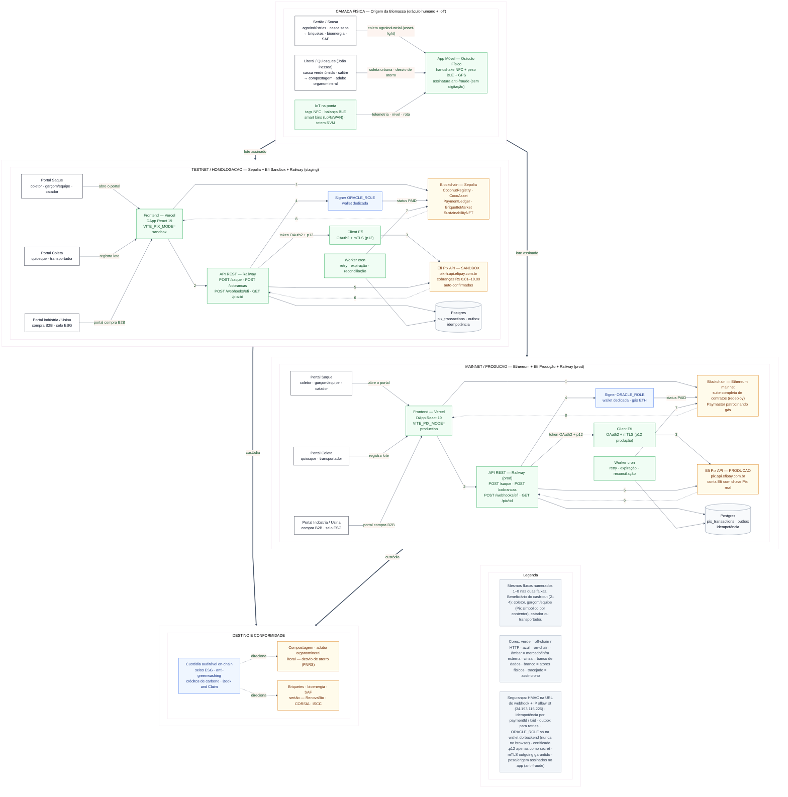

# Diagrama de Arquitetura — CoinConut (Integração Pix + Cadeia de Custódia)

Arquitetura geral da CoinConut após o diagnóstico estratégico: a **integração real do Pix (Efí)** permanece o núcleo de liquidação, e ao redor dela a **camada física/IoT** que garante a qualidade do lote na origem e o **destino comercial dual** da biomassa.

Três linhas de leitura:
1. **Camada Física (topo):** origem da biomassa — Sertão agroindustrial (Sousa → SAF/bioenergia) e Litoral/quiosques (casca verde → compostagem) — com IoT (NFC, balança BLE, smart bins, totem RVM) e o App Móvel como oráculo físico assinado (anti-fraude, sem digitação manual).
2. **Plataforma (meio):** faixas **TESTNET** (Sepolia + Efí Sandbox + Railway staging) e **MAINNET** (Ethereum + Efí Produção + Railway prod). Mesmo código; mudam só as variáveis de ambiente.
3. **Destino e Conformidade (base):** compostagem/adubo (PNRS) no litoral, briquetes/bioenergia/SAF (RenovaBio/CORSIA) no sertão, com custódia auditável on-chain (selos ESG, anti-greenwashing).

Fluxos numerados (iguais nas duas faixas):
1. `registerDelivery` → `PaymentCreated` (PENDING) — on-chain, com dados IoT do lote (NFC + peso BLE + GPS)
2. `POST /api/saque` com assinatura da wallet — off-chain (beneficiário: coletor, garçom/equipe, catador ou transportador)
3. Efí `POST /v2/pix` (envio cash-out para a chave Pix) — off-chain mTLS
4. `confirmPayment(paymentId, endToEndId)` — on-chain (o `endToEndId` vira o `pixProof`)
5. Efí `POST /v2/cob` → QR Code copia-e-cola para a Indústria/Usina (cash-in, B2B) — off-chain
6. Webhook Efí `POST {url}/pix?hmac=...` (validação HMAC + IP allowlist) — assíncrono
7. `confirmPurchase` / `confirmPayment` — on-chain
8. Eventos `PaymentConfirmed` / `PaymentFailed` → UI (polling/escuta) — on-chain

MVP asset-light: a CoinConut não opera frota própria — integra balanças das agroindústrias e transportadoras já contratadas; inicia nos geradores de grande escala.

