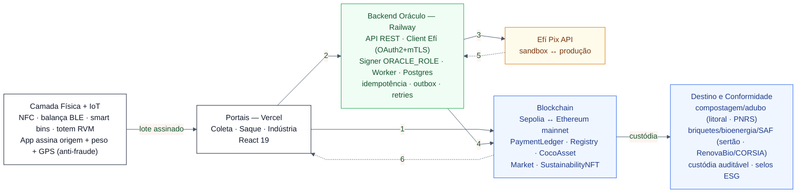

# Diagrama de Arquitetura Resumido — CoinConut (Pix + Custódia)

Versão enxuta para explicação rápida (pitch / alinhamento de equipe). A versão completa está em `diagrama_arquitetura_coinconut.md`.

**Leitura em 6 passos (mesmos nos dois ambientes):**
1. `registerDelivery` → `PaymentCreated` (PENDING) — on-chain, com dados IoT do lote
2. `POST /saque` (cash-out ao coletor/garçom/catador) ou `POST /cobrancas` (cash-in da Indústria) — off-chain
3. Efí `POST /v2/pix` (envia Pix) ou `POST /v2/cob` (gera QR copia-e-cola) — off-chain mTLS
4. `confirmPayment` / `confirmPurchase` pelo Signer `ORACLE_ROLE` — on-chain (`pixProof = endToEndId`)
5. Webhook Efí `POST {url}/pix?hmac=...` — assíncrono (HMAC + IP allowlist)
6. Evento `PaymentConfirmed` → UI

**Ambientes (mesmo código, só env vars mudam):**
- **TESTNET:** Sepolia + Efí Sandbox (`pix-h.api.efipay.com.br`, cobranças R$ 0,01–10,00 auto-confirmam) + Railway staging
- **MAINNET:** Ethereum + Efí Produção (`pix.api.efipay.com.br`, chave Pix real) + Railway prod

Legenda de cores: branco = atores físicos · verde = off-chain/Railway · âmbar = Efí (infra externa) · azul = on-chain/marketplace · tracejado = assíncrono.
Segurança: `ORACLE_ROLE` só na wallet do backend · HMAC na URL do webhook + IP allowlist (34.193.116.226) · `.p12` só como secret · mTLS outgoing.
